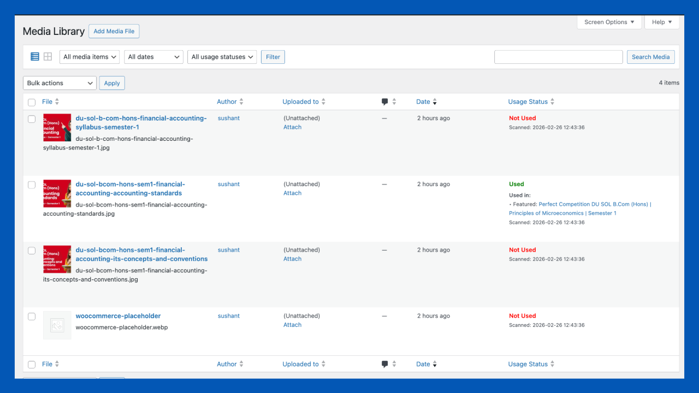
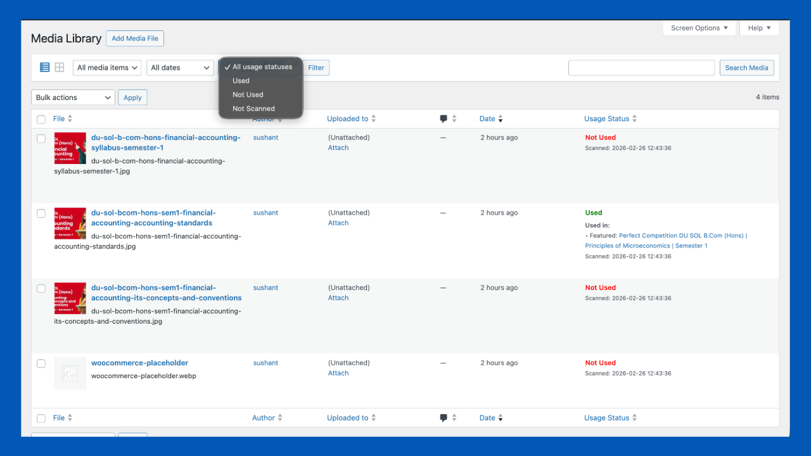

# Sushant Media Scanner

A lightweight, premium WordPress plugin that helps website owners detect exactly where images are used, identify unused media, and optimize their Media Library safely.

## Why use this plugin?
Most media cleanup plugins just guess. They look for image URLs in post content and if they don't find them, they flag the image as "Unused." This is dangerous if you use page builders like Elementor.

**Sushant Media Scanner is different.** It deeply parses Elementor JSON data, featured images, custom fields, and post content to give you a 100% accurate usage report.

## Features

- **Deep Elementor Support:** Scans `_elementor_data` to find images hidden inside page builder layouts.
- **Premium Dashboard:** A clean, minimalist interface showing your total media, used, and unused counts.
- **Scan Logs:** Keeps a history of your last 10 scans, showing time taken, items scanned, and unused assets found.
- **Individual Scanning:** Don't want to scan 5,000 images? Click "Scan Now" on any single image in the Media Library.
- **CSV Export:** Download a full report of your media usage.
- **Multi-Usage Detection:** Detects if an image is used in multiple posts, not just the first one.
- **Privacy First:** Opt-in telemetry to help improve the plugin. Fully anonymous, no personal data, domains, or images are ever collected.
- **Modular Architecture:** Built with modern PHP standards, separate classes, and clean code for maximum performance.

## Screenshots

### The Dashboard

### Media Library Integration

## Installation

1. Upload the `sushant-media-scanner` folder to the `/wp-content/plugins/` directory.
2. Activate the plugin through the 'Plugins' menu in WordPress.
3. Go to **Media > Scan Media Usage** to run your first scan.

##  Privacy & Telemetry
By default, this plugin collects **zero data**. 
If you explicitly opt-in via the plugin settings, it will send an anonymous weekly ping containing:
- WordPress version
- PHP version
- Whether Elementor is active (Yes/No)
- Total media count
- Total scanned count

It **never** sends your site URL, IP address, image URLs, or post content.

## Author
**Sushant Kumar**
- Website: [https://thesushant.in](https://thesushant.in)
- Portfolio: [https://thesushant.in/portfolio](https://thesushant.in/portfolio)
- LinkedIn: [https://linkedin.com/in/myselfsushaant](https://linkedin.com/in/myselfsushaant)

## License
Licensed under GPL-2.0. This project is open source and may be modified and redistributed under the terms of the GNU General Public License v2.0 or later.